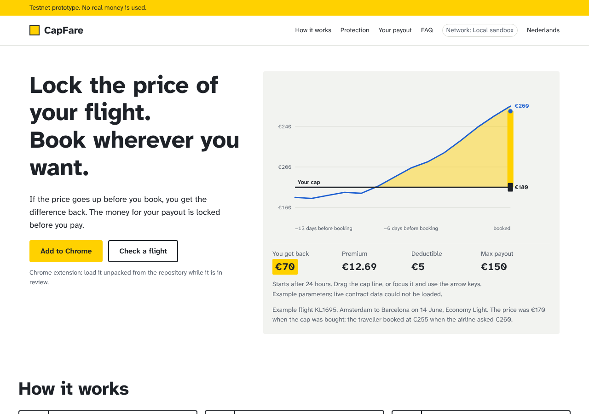
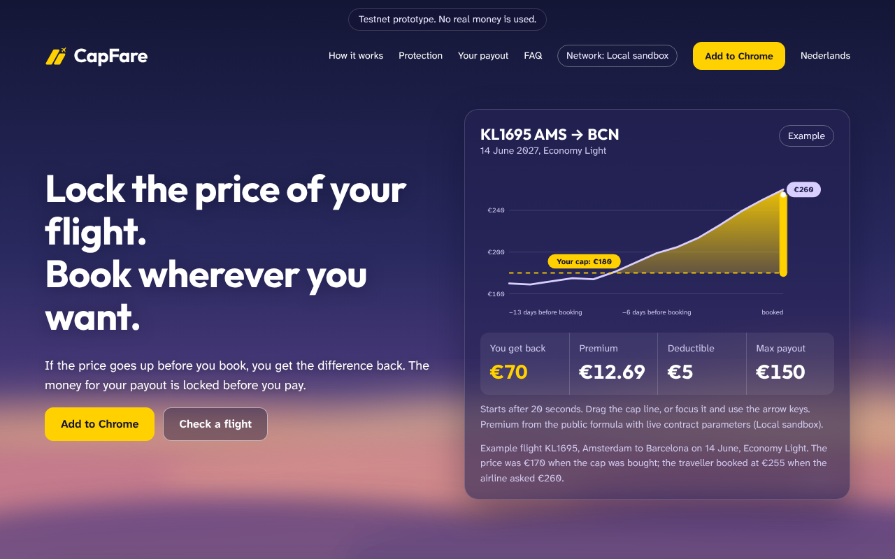
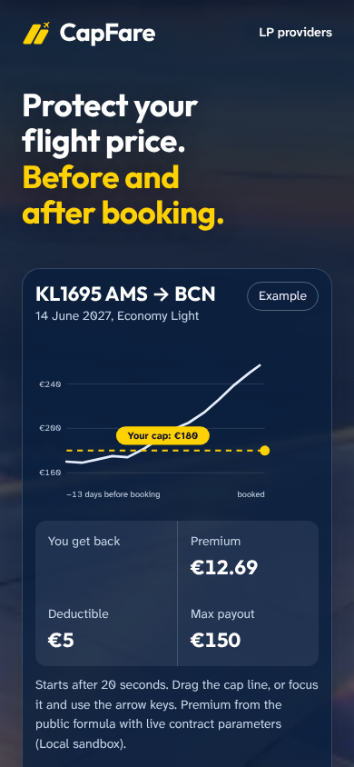
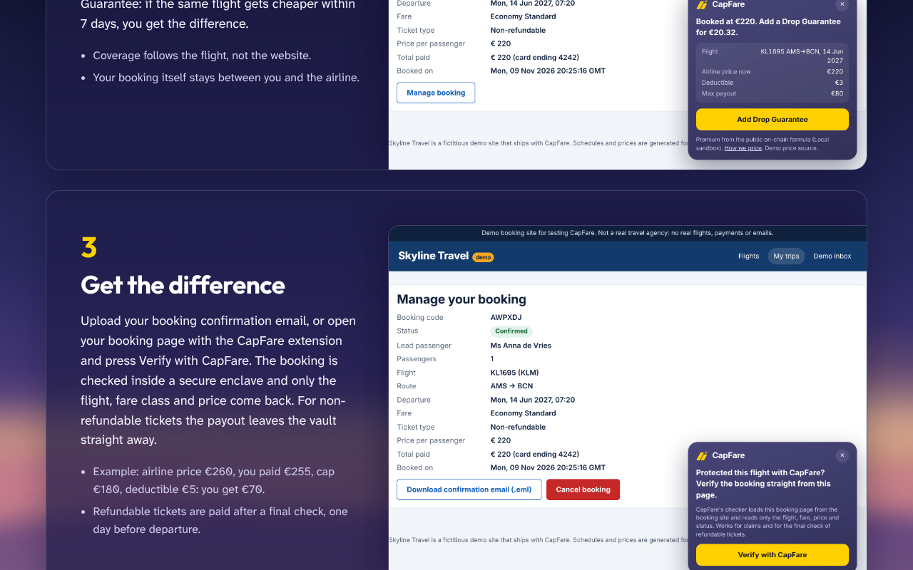
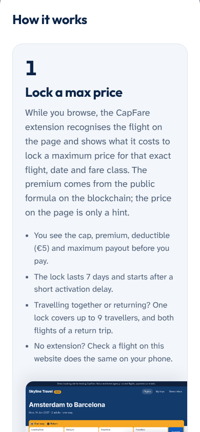

# Landing page design plan

Job of the page: in ten seconds a traveller understands that they can **lock a maximum price
on one specific flight, book anywhere, and get the difference back — and that the money for
that payout already exists**.

## 1. First plan

### Colours (light scheme)

| Name | Hex | Role |
|---|---|---|
| Signal yellow | `#FFD100` | The single accent. Fills only (primary button, payout area in the chart, focus ring). Never text on white. |
| Graphite | `#1E2228` | Body text, headings, the cap line. 15.6:1 on white. |
| Slate | `#5A626E` | Secondary text, axis labels. 6.4:1 on white. |
| Fare blue | `#1D5FD1` | The price line in the chart and inline links. 5.9:1 on white. |
| Concourse | `#F2F3F0` | Alternate section surface, chart background. |
| Paper | `#FFFFFF` | Main surface. |

Dark scheme tokens: background `#121519`, surface `#1B1F25`, text `#F1F2EE`, slate `#A7AEB8`,
fare blue `#7FAEFF`, yellow unchanged (graphite text on yellow in both schemes).

### Type

* **Atkinson Hyperlegible Next** (variable, self-hosted via Fontsource). Designed by the
  Braille Institute for maximum character distinction (1/l/I, 0/O) — the same job airport
  signage does. One family, weights 400/600/750.
* Scale (rem): 0.875 · 1 · 1.125 · 1.375 · 1.75 · 2.5 · 3.25 (hero headline on desktop).
* Prices and figures use tabular numerals (`font-variant-numeric: tabular-nums`) so columns of
  euros line up like a departure board. No monospace.
* Body line length ≤ 68 characters (`max-width: 34em`).

### Wireframe (desktop)

```
┌──────────────────────────────────────────────────────────────────────────────┐
│ CapFare                         How it works  Protection  Vaults  FAQ   EN|NL │
├──────────────────────────────────────────────────────────────────────────────┤
│ Lock the price of your flight.          ┌───────────────────────────────────┐ │
│ Book wherever you want.                 │ Example flight: KL1695 AMS→BCN     │ │
│                                         │ 14 Jun · Economy Light             │ │
│ If the price goes up before you book,   │      price line ──────╱‾‾‾ €260    │ │
│ you get the difference back. The money  │ ═════ your cap €180 ═[drag]══════  │ │
│ for your payout is locked before you    │ ////// you get back €70 //////     │ │
│ pay.                                    │ premium €4.60 · deductible €5 ·    │ │
│                                         │ max payout €150 · example params   │ │
│ [ Add to Chrome ]  [ Check a flight ]   └───────────────────────────────────┘ │
├──────────────────────────────────────────────────────────────────────────────┤
│ How it works   1 Lock a max price   2 Book anywhere   3 Get the difference    │
│                (boarding-pass stub) (confirmation)    (payout slip)           │
├──────────────────────────────────────────────────────────────────────────────┤
│ Two kinds of protection   Price Cap (before booking) | Drop Guarantee (after) │
│                           worked example with numbers | worked example         │
├──────────────────────────────────────────────────────────────────────────────┤
│ Book where you want — coverage follows the flight, not the website           │
├──────────────────────────────────────────────────────────────────────────────┤
│ Your payout already exists   total assets | locked | active | solvency ✓  TESTNET │
├──────────────────────────────────────────────────────────────────────────────┤
│ We never see who you are · The fine print · For liquidity providers · FAQ    │
├──────────────────────────────────────────────────────────────────────────────┤
│ Testnet notice · GitHub · Docs · Transparency · X · Legal                    │
└──────────────────────────────────────────────────────────────────────────────┘
```

Mobile (360 px): one column; the chart comes directly after the headline (before the
sub-line) because it *is* the explanation; CTAs stack full-width.

### Alignment rules

* 12-column grid, 1200 px max width, 24 px gutters; text blocks start on column 1, the chart
  spans columns 7–12 on desktop.
* One left edge per section; headings and body share it. No centred body text.
* Vertical rhythm in multiples of 8 px; sections separated by 96 px (desktop) / 64 px (mobile).
* Numbers right-aligned in tables; euro signs before amounts in both locales.

### Principles specific to CapFare

1. **One flight, one number.** Every example names a flight, a date, a fare class and an amount
   in euros. No abstract "save money" claims.
2. **Yellow means your money.** The accent appears only where the user acts (primary button)
   or where their payout is shown (chart fill). Nothing decorative is yellow.
3. **Show that the money exists.** Live vault figures read from the contracts, each marked
   Testnet, with a clear stale/error state — never placeholder numbers.
4. **Wayfinding over decoration.** Structure borrowed from signage and boarding passes
   (labels, stubs, separators); no illustrations of planes, no gradients, no glow.

## 2. Review against the brief (before coding)

| First-plan element | Problem | Revision |
|---|---|---|
| "How it works" as three cards with an icon each | Generic SaaS default; identical rounded cards with soft shadows is a listed tell. | Each step is a flat strip in the boarding-pass vernacular: a perforated stub edge, the step number set like a gate number, one sentence. No shadows. |
| A stats row under the hero ("€X locked · N policies") | "Big number with small label as the hero" is a listed tell; also duplicates section 4. | Removed from the hero. Live figures appear only in "Your payout already exists", in a table with the Testnet label per row. |
| Small all-caps labels above each heading ("PROTECTION", "VAULTS") | Listed tell (all-caps eyebrows). | Removed. Headings carry the meaning alone. |
| Highlighting "the difference" in yellow in the headline | Listed tell (accenting one word). | Headline is plain graphite. The yellow appears in the chart's payout area instead, where it carries information. |
| Meta line "KL1695 · AMS→BCN · 14 Jun · Economy Light" | Middle-dot meta strings are a listed tell. | Chart caption is a short sentence: "Example flight KL1695, Amsterdam to Barcelona on 14 June, Economy Light." |
| Fade-in on every section | Brief allows one orchestrated motion only. | Only the hero chart animates on load (price line draws, crosses the cap, payout area fills, figure appears). Respects `prefers-reduced-motion`. |
| Button text "Get started →" | Vague, and arrows appended to button text are a listed tell. | "Add to Chrome" and "Check a flight". |
| Airline logos in "Book where you want" | Brief forbids logos. | Text only, and only sites with working adapters (currently: the CapFare demo airline page and klm.com quote-only overlay; listed honestly). |
| Product comparison numbered 1/2 | Not a sequence. | Two columns with names, no numbers. |

What stays: the yellow-on-graphite primary button (wayfinding sign), the departure-board
tabular figures, and the chart as the single bold element.

## 3. Build critique and revisions

### Revision 1 — first build (plan as written)



Review of the first screenshots at 1280 px and 390 px:

* Section padding overrode the grid gutters (sections started at 40 px instead of 64 px). Fixed.
* Chart axis labels became ~6 px on phones. The chart now switches to a compact geometry
  below 600 px instead of scaling the desktop drawing down.
* The mobile header wrapped into three rows. Anchor links are hidden on small screens.
* **Removed decorative element:** the boarding-pass "stub" labels under each step
  ("Max price", "Booked", "Paid to you"). They repeated the step titles and carried no
  information. Later the brand square in the header was replaced by the real logo.

### Revision 2 — the owner's reference: dusk sky hero, glass fare card

The project owner supplied a reference mockup (dusk sky above the clouds, a translucent
fare card, yellow call to action) and asked for the page to follow it "but less generic".
This overrides parts of the original plan (white surfaces, no gradients). What we took and
what we deliberately left out:

| From the reference | Kept? | Why |
|---|---|---|
| Dusk sky behind the hero, drawn in SVG (no stock photo) | Kept | It is the owner's direction and ties the page to flying without clip-art. The horizon was moved low so hero text stays on the dark part (contrast ≥ 7:1 for body text). |
| Glass fare card with route header, dashed yellow cap line with a label pill, lavender price line, yellow payout fill | Kept | It carries the product's one idea; the cap pill is the drag handle. |
| Yellow primary button in the header and the hero | Kept | Same rule as before: yellow = your money / your action. |
| Eyebrow pill "Flight price protection on NEAR" | Dropped | Listed tell; the headline already says it. |
| Accent word with a hand-drawn underline ("any site") | Dropped | Listed tell. |
| Check-mark trio under the buttons ("Payout in seconds" …) | Dropped | Two of the three claims were not accurate for refundable tickets. |
| Four-icon trust strip | Dropped | Generic; the live vault figures make the same point with real numbers. |
| "Works with KLM, Transavia, Booking.com" | Dropped | Not true today; the brief forbids naming sites without working adapters. |
| Icon cards with arrows for "How it works" | Replaced | See revision 4. |
| "Watch 1-min demo" button | Dropped | No video yet; "Check a flight" does something real. |

### Revision 3 — glass across the whole site, new logo

The owner asked for the translucent "bubble" style everywhere, including the Chrome
extension, and supplied the CapFare logo (two slanted bars and a climbing plane). The sky is
now fixed behind every page; content sits on glass panels whose opacity (0.72) keeps body
text at ≥ 4.5:1 even over the bright horizon. Headings and the wordmark use **Outfit**
(closest open font to the logo's lettering); body text stays Atkinson Hyperlegible Next.
The site uses one (dark) scheme in both system modes. The extension overlay uses the same
glass panel and logo mark. To avoid a page of identical panels, related sections are paired
side by side (privacy with "book where you want", fine print with the LP note).

### Revision 4 — one large section per real screenshot

At the owner's request "How it works" became three large sections, each with the
explanation on the left and a real screenshot on the right, bleeding to the panel's right and
bottom edge. The screenshots are not mock-ups: steps 1 and 2 are captured from the built
extension running on the demo booking site (`scripts/src/extension-shots.ts`), step 3 from
the web app at the end of the end-to-end test (`web/e2e/flow.spec.ts`). The hero chart was
made shorter so the card has room beneath it.

### Revision 5 — screenshots from the mock booking site

With Skyline Travel (demo) in place, the "How it works" screenshots are retaken on it: the cap
offer on search results, the Drop Guarantee offer on the confirmation page, and **Verify with
CapFare** on the manage-booking page (step 3 now shows the live check rather than the payout
card). All three are captured from the built extension by `scripts/src/extension-shots.ts`.

### Current screenshots

| Desktop (1280 px) | Mobile (390 px) |
|---|---|
|  |  |
|  |  |

### Revision 6 — photographic hero and white landing body

The owner's latest reference replaces the illustrated landing sky with a real in-flight
photograph and a white page below it. The hero and navigation now sit over a locally hosted,
optimized WebP photograph of an aircraft wing above the clouds at sunset. A dark overlay
keeps the existing white hero text readable; the interactive fare chart retains its glass
surface. Photo source and license are recorded in `web/public/images/README.md`.

The rest of the landing page is one continuous white surface with rounded upper corners
(48 px on desktop, 32 px on mobile) overlapping the bottom of the hero. Locally scoped light
tokens provide dark text, purple links and readable live/error states. Existing copy,
translations, screenshots and behavior are preserved. Other application pages retain their
existing dusk theme.

Validation: production web build and the four existing hero tests passed. Browser checks at
1440 px and 390 px, in English and Dutch, confirmed image loading, no horizontal overflow,
white content surfaces, no JavaScript errors and keyboard interaction with the price cap.

### Revision 7 — navy/yellow, concise comparison and branded aircraft

The landing palette now uses navy and yellow, retaining the white page and rounded hero
transition. The header begins at the top of the page: its duplicate prototype strip and
network badge are removed, with the prototype notice retained in the footer. The language
toggle is removed and an LP providers link opens `/lp`, including on phones.

The hero now describes both Price Cap and Drop Guarantee. Protection options use equal-width
navy comparison columns with timing, short descriptions, deductible, maximum payout and one
worked example each. Lower sections have shorter copy; policy conditions and FAQ answers
remain available through native disclosure controls. Live vault figures retain real data and
error states while removing repeated network labels from the landing view.

New content enters focus with a short bounded blur animation using IntersectionObserver and
the Web Animations API. Content is visible without JavaScript, effects run once, and reduced
motion bypasses them. No animation dependency was added.

The hero photograph has a CapFare livery edit: yellow winglet/fairings and a
perspective-matched wing logo positioned below the hero copy. Asset provenance is recorded
in `web/public/images/README.md`.
