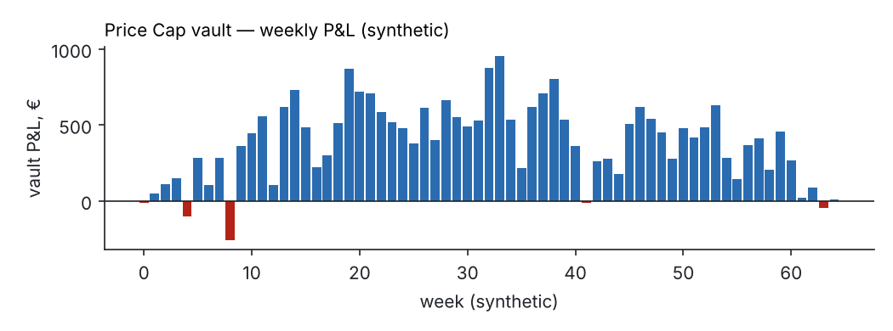
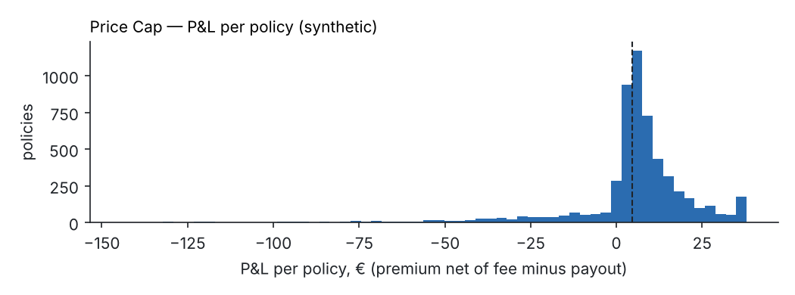
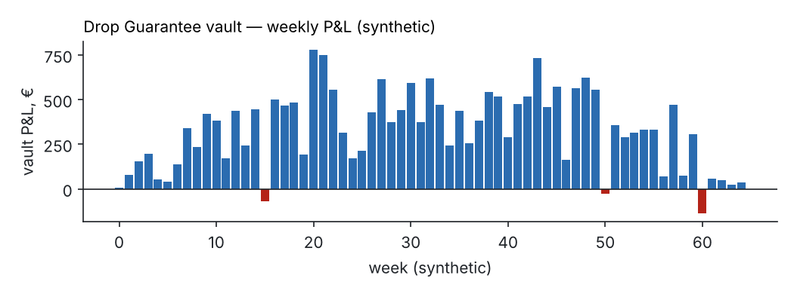
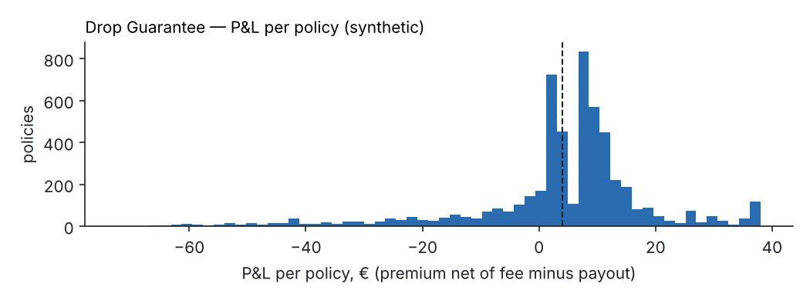
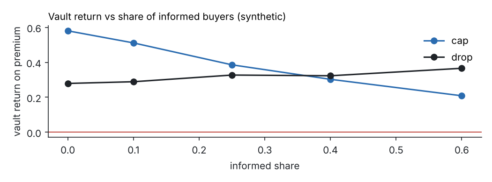
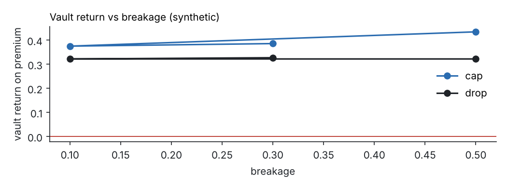

# Pricing and backtest

> **All numbers on this page come from SYNTHETIC price paths** generated by
> `backtest/capfare_backtest/data.py`. They show that the method works and how sensitive
> the vaults are to buyer behaviour. They are not evidence about real airline prices.
> Re-run with real data via `CsvSource` before any non-testnet use.

Generated by `python -m capfare_backtest.cli run` (seed 7, 1500 flights,
4.0 buyers per flight, informed share 25%).

## Method

1. Generate per-flight fare paths for the covered fare class over 120 days, every 6 hours:
   fare-bucket closures driven by load factor and time (upward drift toward departure),
   bursts of bucket changes (volatility clusters), short promotions, sell-outs of the
   cheapest class, and seasonal flights.
2. Simulate buyers per flight: uninformed, informed (buy only when momentum or availability
   signals are high, then book at the worst moment for the vault), breakage (never book),
   and refundable-fare cancellers (payout voided by the final status check).
3. Price every sale with the exact on-chain formula (`formula.py` is an integer port of
   `contracts/core`, checked against shared test vectors), apply activation delay,
   deductible, max payout, per-flight exposure caps and the sold-out premium refund.
4. Calibrate the public parameters: signal multipliers from payout ratios per bucket
   (shrunk toward 1.0), moneyness slope by least squares, base table = expected payout per
   (price, days-to-departure) cell divided by a target loss ratio.
5. Search deductible × max payout × target loss ratio; keep sets whose median premium on
   tickets up to €300 is ≤ €10 and whose vault return is positive; prefer larger max payouts.

The two products are priced and capitalised **independently**.

## Price Cap

Chosen: deductible €5, max payout €150, target loss ratio 0.55.

| Metric | Value |
|---|---|
| Policies simulated | 5489 |
| Median premium (all / tickets ≤ €300) | €10.02 / €9.74 |
| 90th percentile premium | €29.84 |
| Claim rate (payout > 0) | 24% |
| Loss ratio (payouts / premiums) | 0.59 |
| Vault return on premium (after 5% fee) | +0.36 |
| Break-even premium / max payout | 0.051 |
| Average premium / max payout | 0.086 |
| Worst week / worst 4 weeks | €-260 / €11 |

## Drop Guarantee

Chosen: deductible €10, max payout €80, target loss ratio 0.65.

| Metric | Value |
|---|---|
| Policies simulated | 5429 |
| Median premium (all / tickets ≤ €300) | €9.68 / €9.46 |
| 90th percentile premium | €31.08 |
| Claim rate (payout > 0) | 35% |
| Loss ratio (payouts / premiums) | 0.65 |
| Vault return on premium (after 5% fee) | +0.30 |
| Break-even premium / max payout | 0.106 |
| Average premium / max payout | 0.163 |
| Worst week / worst 4 weeks | €-138 / €-11 |

## Sensitivity to buyer selection

| Product | Informed share | Breakage | Loss ratio | Vault return |
|---|---|---|---|---|
| cap | 0% | 30% | 0.37 | +0.58 |
| drop | 0% | 30% | 0.67 | +0.28 |
| cap | 10% | 30% | 0.44 | +0.51 |
| drop | 10% | 30% | 0.66 | +0.29 |
| cap | 25% | 30% | 0.56 | +0.39 |
| drop | 25% | 30% | 0.62 | +0.33 |
| cap | 40% | 30% | 0.65 | +0.30 |
| drop | 40% | 30% | 0.63 | +0.32 |
| cap | 60% | 30% | 0.74 | +0.21 |
| drop | 60% | 30% | 0.58 | +0.37 |
| cap | 25% | 10% | 0.57 | +0.38 |
| drop | 25% | 10% | 0.63 | +0.32 |
| cap | 25% | 50% | 0.52 | +0.43 |
| drop | 25% | 50% | 0.63 | +0.32 |

## Required capital

Full collateralisation already locks every policy's max payout. The extra loss buffer
below is the 52-week cumulative loss exceeded with 1% probability (bootstrap of the
simulated per-policy P&L).

| Product | Policies / week | Collateral (live policies) | Loss buffer (1% ruin) | P(loss after a year) |
|---|---|---|---|---|
| cap | 10 | €1,500 | €171 | 0% |
| drop | 10 | €800 | €138 | 0% |
| cap | 50 | €7,500 | €102 | 0% |
| drop | 50 | €4,000 | €55 | 0% |
| cap | 200 | €30,000 | €0 | 0% |
| drop | 200 | €16,000 | €0 | 0% |

## Combined view (secondary)

Cap + drop together: premiums €141,957, payouts €87,947. No hedge between the products is assumed;
they sit in separate vaults.

## Limitations

- Synthetic paths: the shape of real airline fare curves, promotion frequency and
  sell-out timing will differ. Parameters must be re-fitted on real observations.
- Buyer behaviour is modelled, not observed. The informed-buyer share and breakage are the
  biggest drivers (see the sensitivity table); the real values are unknown.
- Vault utilisation is held at 30% when pricing; the on-chain utilisation surcharge is not
  exercised by the simulation.
- OTA prices are modelled as the airline price ±3%; payout uses min(index, paid).
- In this model informed Drop buyers (buying while prices fall) pay the high momentum
  multiplier, so they do not raise the loss ratio; real informed behaviour may differ.
- FX between EUR and USDC is fixed per policy at purchase and not simulated.
- Group collusion beyond the informed-buyer model (many accounts on one flight) is limited
  by per-user and per-flight caps but not simulated explicitly.
